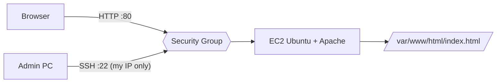

# AWS EC2 Web Server - Unit 3 Cloud Security Assignment

**PRN:** 2124UCSM1057 | **Class:** 3rd Year | **Department:** Cyber Security

**Topic:** Set up a web application on Amazon EC2 (Ubuntu 24.04 + Apache), secured with a least-privilege Security Group.

Full step-by-step report (PDF): [docs/EC2_WebApp_Assignment.pdf](docs/EC2_WebApp_Assignment.pdf)

## Architecture

## Security Group (webserver-sg)

| Type | Port | Source | Purpose |
|---|---|---|---|
| SSH | 22 | My IP (/32) | Admin access only from my machine |
| HTTP | 80 | 0.0.0.0/0 | Public web access |

## Steps (summary)

1. Launch a `t2.micro` Ubuntu 24.04 instance with a new RSA `.pem` key pair.
2. Attach the Security Group above.
3. Connect: `chmod 400 key.pem && ssh -i key.pem ubuntu@<PUBLIC_IP>`
4. Install Apache: `sudo apt install apache2 -y && sudo systemctl enable --now apache2`
5. Deploy [app/index.html](app/index.html) to `/var/www/html/` (or run [scripts/setup-apache.sh](scripts/setup-apache.sh)).
6. Verify in a browser at `http://<PUBLIC_IP>`.

## Screenshots

See the [screenshots](screenshots/) folder.

## Security measures

- SSH limited to one IP, key-based login only, key file `chmod 400`
- Only ports 22 and 80 open; everything else denied by default
- Web files owned by `www-data`, mode 755
- System patched with `apt update && apt upgrade`
- Hardening: `ServerTokens Prod`, `ServerSignature Off`, IMDSv2 required, unattended-upgrades
